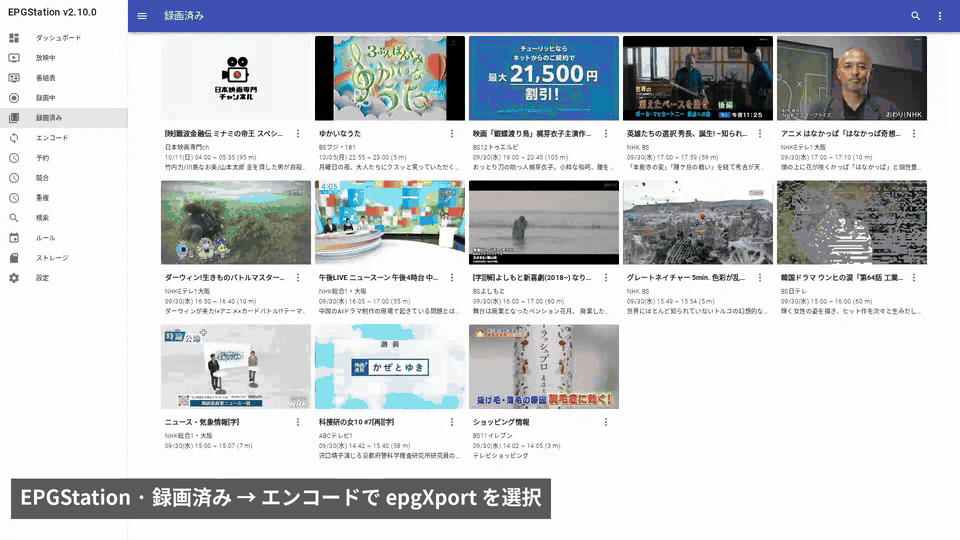

# epgXport

[English](README.md)

epgXport は [EPGStation](https://github.com/l3tnun/EPGStation) の録画を **Jellyfin・Emby・Kodi・Plex** のライブラリに入れるツールです。EPGStation の「エンコード」コマンドとして動きますが、エンコードは一切しません。代わりに次のことを行います。

- 録画をライブラリに**ハードリンク**します。ディスク容量も時間もかかりません。ライブラリが別のファイルシステムにある場合はコピーします（`link` を `copy` にすると常にコピー）。Jellyfin 12 向けに、録画を**リマックス**して置くこともできます（「Jellyfin 12 での再生」参照）。
- 日本の番組表の複雑な番組名から、きれいな**番組名**・話数・サブタイトルを取り出します。例: `[新]アニメ　薬屋のひとりごと　＃４９「毒見役」[字]` → `薬屋のひとりごと`、第 49 話、`毒見役`。
- 放送の**字幕**を `.ja.ass` / `.ja.srt` の字幕ファイルとして保存することもできます（任意、「字幕」参照）。
- 番組情報をすべて入れた **NFO ファイル**（Kodi 形式。4 つのサーバーすべてが読めます）を書きます: 番組概要、番組詳細の全文、出演者とスタッフ、チャンネル、ジャンル、放送時間、放送フラグ（新番組、最終回、再放送、字幕…）。
- **EPGStation のサムネイル**を録画の隣にリンクし、エピソード（または映画）の画像にします。

`epgXport.js` の 1 ファイルだけで、依存パッケージはありません。EPGStation が使っている Node.js で動き（Node.js 14.14 以降。18 と 24 で確認済み）、**オンラインへの問い合わせは一切しません**。メディアサーバー側のスクレイパー（TMDB、TVDB…）は、見つかる番組についてはこれまでどおりアートワークやメタデータを取得します。見つからない番組には NFO の情報が使われます。



動画（1:44）: [epgXport-demo.mp4](https://cdn.jsdelivr.net/gh/MyFeetHurt/epgXport@main/media/epgXport-demo.mp4) ・ スクリーンショット: [EPGStation](media/epgstation.png) / [Jellyfin](media/jellyfin-actor.png)

## ライブラリの構成

```
<ライブラリ>/TV/<番組名>/tvshow.nfo
<ライブラリ>/TV/<番組名>/<番組名> - 2026-09-30 2300 - <サブタイトル>.ts   （同名の .nfo、-thumb.jpg、.jpg、任意で .ja.ass/.ja.srt）
<ライブラリ>/Movies/<作品名> (<公開年>)/<作品名> (<公開年>).ts           （.nfo と -thumb.jpg）
<ライブラリ>/Movies/<作品名> (<公開年>)/<作品名> (<公開年>) - 吹替版.ts   （吹替・字幕の放送: - 吹替版 / - 字幕版）
```

- 番組のエピソードは**放送日時**で名前を付けます。シーズンフォルダも `S01E05` もありません。4 つのサーバーはどれも日付名のエピソードを認識し、オンライン情報との日付による照合も働きます。番組名に含まれる話数は NFO にだけ書きます。
- 特番・ダイジェスト・総集編・短縮版（`5min.`、`ミニ`/`mini`、`1分版`、`PR`、`20周年PR`、`直前SP`、`スペシャル`、`傑作選`、`ダイジェスト`）は同じ番組フォルダに入り、その語はサブタイトル側に移ります（`さわやか自然百景5min.(36)奈良…` → `さわやか自然百景`、サブタイトル `5min.(36) 奈良…`）。その語の直後の数字は短縮版自体の通し番号なので、サブタイトルに残し、話数には使いません。
- 新しい番組名が**既存の**番組フォルダ名で始まり、そのあとに自然な区切り（スペース、`!`、`?`、`☆`、`“`、`~`、`▽`、`／`…）が続く場合は、そのフォルダに入れて残りをサブタイトルにします: `徹子の部屋 クワバタオハラ` は `徹子の部屋` に入ります。既存のフォルダ名は 5 文字以上（スペースと記号を除く）、漢字を含むなら 4 文字以上（`時論公論`）、`!`/`?` で終わるなら 3 文字以上（`ZIP!`）が必要です。`ニュース`、`ラグビー`、`まもなく` のような短い一般的な名前のフォルダが別の番組を取り込むことはありません。ルールでディレクトリ（DIR）を指定した場合は使われません。フォルダ名は変更しないので、これが役立つのは番組名だけの回が先に録画された場合です。
- 番組名が空の番組は、チャンネル名のフォルダに入ります。
- ジャンルが「映画」（または `[映]` フラグ付き）で、番組名に話数がないものを映画として扱います。公開年は番組名か番組情報（例: `（１９９９年　１２０分）`）から取ります。公開年がない場合、フォルダ名は `<作品名>` だけになります。
- 吹替（`吹替版`、`日本語吹替版`、`[吹]`）や字幕（`字幕版`、`字幕スーパー`）と示された映画の放送は、名前のあとに ` - 吹替版` か ` - 字幕版` が付き、同じフォルダに入ります。Jellyfin・Emby・Plex では 1 本の映画の別バージョンとして表示されます。`[字]` だけの場合は字幕放送（クローズドキャプション）の意味なのでバージョンにはなりません。
- ファイル名に使えない文字（`/ \ : * ? " < > |`）は全角に置き換え、名前は 255 バイト未満に収めます。
- ファイル名と NFO の日時は、サーバーのタイムゾーンにかかわらず常に**日本時間（JST）**です。意図した動作です。
- 番組フォルダ名に Kodi が話数と読み取りそうな部分（`Type2`、`Stage1`、`S1E2`）がある場合、ファイル名から番組名を省きます（`2026-09-30 2300 - 決勝.ts`）。サブタイトルがそういう形の場合もファイル名には入れません（NFO には残ります）。そうしないと Kodi が日付ではなくそれを話数として扱ってしまいます。
- epgXport はライブラリ内のファイル（サムネイルを含む）を削除・上書きしません。その名前がすでに別の録画で使われている場合（同じ番組を 2 つのチャンネルで録画した、同名の映画が 2 本ある、など）は、新しい方の名前のあとに ` (2)`、` (3)`… が付きます。同じ録画でもう一度実行しても何も変わりません（同じファイルであること、コピーやリマックスの場合は NFO が同一であることで判定します）。

## サムネイル

epgXport は各録画の隣に EPGStation のサムネイルを置きます。番組のエピソードには `<名前>-thumb.jpg` と `<名前>.jpg`、映画には `<名前>-thumb.jpg` です。EPGStation のサムネイルへのリンク（またはコピー）なので、容量はほとんど使いません。Jellyfin・Emby・Kodi は `-thumb.jpg` を、Plex は `<名前>.jpg` を使います。番組のポスターや背景画像はこれまでどおりサーバーのオンラインスクレイパーから取得され、番組や映画のフォルダに自分で `poster.jpg` / `fanart.jpg` を置くこともできます。epgXport がそれらを上書きすることはありません。（映画に `<名前>.jpg` を置かないのは、Jellyfin と Plex がそれをポスターとして使ってしまうためです。）

- **Plex:** *ローカルアセットを使用*（ライブラリ → 編集 → 高度な設定）をオンにしてください。オフだとサムネイルは使われません。
- **Jellyfin:** ローカルのサムネイルは、ダウンロードしたエピソード画像や Screen Grabber より常に優先されます。設定は不要です。Jellyfin がエピソード画像を作るために録画に対して ffmpeg を実行することもなくなるので、解析できないエピソード（「既知の制限」参照）にもサムネイルが付きます。*アートワークをメディアフォルダに保存* をオンにしてエピソード画像を手で変更すると、EPGStation 側のサムネイルも上書きされます（ハードリンクなので同じファイルです）。
- **Emby:** 初期設定のままで使えます。`-thumb.jpg` がエピソード画像に、映画では *Thumb* 画像になります（映画のポスターはオンラインのプロバイダーから取得されます）。
- **Kodi:** 初期設定のままで使えます。サムネイルができる前に Kodi に登録された録画は、その録画で *更新* を選ぶまで Kodi 自身が作った画像のままです。
- 画像は EPGStation が録画開始の数秒後に撮るフレームです（EPGStation の設定の `thumbnailPosition`）。録画マージンがあると、前の番組の終わりや CM が写ることがあります。サムネイルがない場合、epgXport はサムネイルなしで処理を続け、サーバーが自分で画像を作ります。

ファイルの探し方: EPGStation は録画の ID（`RECORDEDID`）を渡し、サムネイルを `<サムネイルフォルダ>/<ID>.jpg` として保存します（その名前が使われていた場合は `<ID>(1).jpg`、`<ID>(2).jpg`…。番組開始後に書かれた最も大きい番号を使います）。EPGStation は epgXport の起動と同時にサムネイルを作るので、epgXport は最大 `thumbnailWait` 秒（初期値 60）待ち、現れなければサムネイルなしで続けます。画像は NFO と動画より先に置くので、サーバーは最初のスキャンで画像を見つけます。同じ録画でもう一度実行すると、前回なかったサムネイルが追加されます。`RECORDEDID` なしの実行（手動実行）では画像は追加されません。EPGStation の `thumbnail` 設定が初期値の `%ROOT%/thumbnail` でない場合は、`thumbnailDir` を設定してください（「設定」参照）。

## インストール

1. `epgXport.js` を EPGStation の `config/` ディレクトリにコピーします。
2. その隣に `config/epgXport.json` を作ります:

   ```json
   { "library": "/path/to/media" }
   ```

   **絶対パス**で書いてください（相対パスは EPGStation の作業ディレクトリからの相対になります）。Windows では `"D:/Media"` または `"D:\\Media"` と書きます（JSON ではバックスラッシュを 2 つ重ねます）。NTFS のハードリンクも使えます。中に `TV` と `Movies` フォルダが作られます。ハードリンクを使うには、ライブラリが EPGStation の録画ディレクトリと**同じファイルシステム・同じマウント**にある必要があります。そうでない場合はコピーになります（btrfs/XFS では可能なら reflink コピーになり、追加の容量を使いません）。ログの各行に `linked`、`copied`、`remuxed` のどれかが出るので、最初の録画のあとで確認してください。
3. EPGStation の `config/config.yml` にエンコードの項目を追加します。**`suffix` なし**、**`rate: 1.0`** にしてください:

   ```yaml
   encode:
       - name: Library
         cmd: '%NODE% %ROOT%/config/epgXport.js'
         rate: 1.0
   ```

   `suffix` がないと、EPGStation はこの項目を単なるコマンドとして扱い、出力ファイルを期待せず、録画に 2 本目の動画を追加しません。`rate` はタイムアウトを録画時間の何倍にするかの設定です。リンクは 1 秒もかからないので 1.0 で十分です。
4. EPGStation を再起動します。メディアサーバーに入れたい録画のルール（または予約）で、エンコードモード「Library」を選びます。録画済みの番組のページから実行して、以前の録画を追加することもできます。

**Docker:** 録画とライブラリの両方を含む**親ディレクトリを 1 つ**、コンテナ内の同じパスにマウントしてください（例: `/data:/data` として、EPGStation の `recorded` を `/data/recorded`、`library` を `/data/media` にする）。Linux では異なる 2 つのマウントの間でハードリンクできないため（同じディスクのバインドマウント 2 つでも `EXDEV` になります）、`recorded` とライブラリを別々のボリュームにすると、すべての録画が**コピー**され、ディスク使用量が 2 倍になります。btrfs のサブボリューム間でも同じです。`library` には常に**コンテナ内**のパスを書きます。

この項目は EPGStation のエンコードキュー（`concurrentEncodeNum`）を共有するので、実際のエンコードが動いていればその後ろで待ちます。できれば `concurrentEncodeNum` は初期値の 1 のままにしてください。複数同時に動かすと、同じ番組の 2 つの録画が同時に始まったときに、まれにスペースの有無だけが違う 2 つのフォルダができることがあります。

### 「エンコード後に元ファイルを削除」: チェックする前に読んでください

このモードで EPGStation の「元ファイルを削除する」をチェックすると、epgXport の処理が終わった時点で EPGStation が自分の録画ファイルを削除します。ライブラリ側のハードリンクは残るので、動画は Jellyfin・Emby・Kodi・Plex に残ります。ただし EPGStation 上ではその録画の**動画がなくなります**。またライブラリが別のファイルシステムにある場合（リンクではなくコピーされた場合）、残るのはライブラリ側のコピーだけです。「ライブラリへ移動」という動作が欲しいのでなければ、オフのままにしてください。

## 設定

設定はスクリプトの隣の `epgXport.json` から読みます。環境変数がそれより優先され、`EPGXPORT_CONFIG` で別の設定ファイルを指定できます。

2 つ目のエンコード項目に別の設定ファイルを使う場合（例えば 2 つ目のライブラリ）は、`env` を使い、**node をフルパスで**書きます:

```yaml
    - name: epgXport (2nd library)
      cmd: '/usr/bin/env EPGXPORT_CONFIG=%ROOT%/config/epgXport-2.json /usr/bin/node %ROOT%/config/epgXport.js'
      rate: 1.0
```

EPGStation が `%NODE%` を置き換えるのはコマンドの最初の語のときだけなので、`env` のあとの `%NODE%` は終了コード 127 で失敗します。EPGStation 自身が使っている node（EPGStation を動かすユーザーで `which node`）を書いてください。

| JSON キー | 環境変数 | 初期値 | 意味 |
|---|---|---|---|
| `library` | `EPGXPORT_LIBRARY` | （必須） | ライブラリのルート（絶対パス） |
| `tvDir` | `EPGXPORT_TV_DIR` | `TV` | ライブラリ内の番組フォルダ |
| `movieDir` | `EPGXPORT_MOVIE_DIR` | `Movies` | ライブラリ内の映画フォルダ |
| `logFile` | `EPGXPORT_LOG_FILE` | なし | 録画ごとに 1 行をここに追記: 時刻、`linked` / `copied` / `remuxed` / `exists`、録画 → ライブラリのファイル、サムネイルの結果 |
| `thumbnailDir` | `EPGXPORT_THUMBNAIL_DIR` | スクリプトから見て `../thumbnail`（`%ROOT%/thumbnail`） | EPGStation のサムネイルフォルダ（`thumbnail` 設定、絶対パス） |
| `thumbnailWait` | `EPGXPORT_THUMBNAIL_WAIT` | `60` | EPGStation がサムネイルを作り終えるのを待つ秒数。`0` = 1 回だけ見て待たない |
| `link` | `EPGXPORT_LINK` | `hardlink` | `hardlink`: 録画とサムネイルをハードリンクし、できなければコピー。`copy`: 常にコピー（btrfs/XFS では可能なら reflink コピー） |
| `remux` | `EPGXPORT_REMUX` | `false` | `true`: リンクの代わりに ffmpeg で動画をリマックスする（「Jellyfin 12 での再生」参照） |
| `ffmpeg` | `FFMPEG` | `ffmpeg` | `remux` に使う ffmpeg。EPGStation が `FFMPEG` に自分の ffmpeg を設定するので、通常は不要 |
| `ffprobe` | `FFPROBE` | `ffprobe` | リマックスの確認に使う ffprobe。EPGStation が `FFPROBE` を設定するので、通常は不要 |
| `remuxArgs` | （なし） | 下記参照 | 上級者向け: ストリームを選んでコピーする ffmpeg の引数 |
| `subtitles` | `EPGXPORT_SUBTITLES` | `false` | `ass`、`srt`、`both`: 放送の字幕も字幕ファイルとして保存する（「字幕」参照） |
| `subtitleFfmpeg` | `EPGXPORT_SUBTITLE_FFMPEG` | 上の `ffmpeg` | `subtitles` に使う、ARIB 字幕デコーダー入りの ffmpeg |

`link` を `copy` にすると、ライブラリと EPGStation がファイルを共有しないので、メディアサーバーがライブラリに対して行うこと（例えば Jellyfin の *アートワークをメディアフォルダに保存*）が EPGStation の録画やサムネイルを変えることはありません。ファイルシステムが reflink にしない限り、コピーごとにディスク容量を使います。

エラー時はスクリプトが 0 以外の終了コードで終わるので、失敗は EPGStation でエンコード失敗として表示されます。同じ行（またはエラーメッセージ）を標準エラー出力にも書きますが、EPGStation がエンコードコマンドの標準エラー出力をログに残すのは **debug** ログレベルのときだけなので、記録を残したい場合は `logFile` を設定してください。

## Jellyfin 12 での再生

Jellyfin 12 は日本の放送録画（`.ts` / `.m2ts`）の多くを再生できません。映像と音声のほかに ARIB 字幕とデータ放送のストリームが入っていて、Jellyfin 12 はそれを扱えないためです。Jellyfin 10 は同じファイルを問題なく再生でき、Kodi と Plex も同様です。

`"remux": true`（または `EPGXPORT_REMUX=true`）にすると、ハードリンクの代わりに整理したコピーをライブラリに置きます。epgXport は次を実行し、

```
ffmpeg -hide_banner -nostdin -loglevel error -fflags +discardcorrupt -analyzeduration 10M -probesize 32M -i <録画> \
       -map 0:v:0 -map 0:a? -c copy -ignore_unknown -dn -sn -max_muxing_queue_size 1024 -f mpegts -y <ライブラリのファイル>.part
```

結果を ffprobe で確認してから、ライブラリのファイル名に変更します。これは**ストリームコピーで、エンコードではありません**。最初の映像ストリームとすべての音声ストリーム（二か国語・デュアルモノを含む）を、そのまま同じ拡張子の新しい MPEG-TS ファイルにコピーします。字幕とデータ放送はライブラリのファイルには入りません（字幕を残すには `subtitles` をオンにして字幕ファイルにしてください）。EPGStation の録画は変更しません。

- 録画ごとに**ほぼ同じ大きさのディスク容量**（除いたストリームの分だけ少ない）を使い、ffmpeg がコピーする間 CPU とディスク I/O を使います（長い HD 録画で通常 1〜2 分。エンコードはしません）。エンコード項目の `rate: 1.0` のタイムアウトで十分です。
- ffmpeg は EPGStation が使っているもの（エンコードコマンドに `FFMPEG` として渡されます）です。別のものを使うには `ffmpeg` を設定します。
- 受信エラー（大雨の BS などでのパケット欠落）があると、録画に壊れた音声フレームが残ります。`-fflags +discardcorrupt` で ffmpeg が壊れていると判断したパケットを捨てるので、エラーが少しある録画もリマックスできます。
- リマックスのあと、epgXport は新しいファイルの映像と音声の長さを録画と比べます（ffprobe を使います。EPGStation が `FFPROBE` として渡します）。受信エラーが多いと、ffmpeg が「正常に」終わっても音声や映像が何分も欠けることがあるので、2%（最低 10 秒）より短くなったストリームがあればリマックス失敗とします。ffprobe がない場合は確認を省き、ログに `remux not checked` と出ます。
- リマックスに失敗した場合は途中のファイルを削除し、代わりに元の録画をリンク（またはコピー）するので、録画はライブラリに入ります。ログには `linked`（または `copied`）のあとに `; remux failed: <理由>` が出ます。理由は ffmpeg の最後のエラー行、または例えば `audio is 1000 s of 3608 s (damaged recording)` です。
- スクランブルが解除されていない録画（B-CAS カードリーダーがない、契約していないチャンネル、など）はどのプレーヤーでも再生できません。epgXport はファイルの一部を調べてこれを見分け、ffmpeg を実行せずにリンクします。理由は `the recording is scrambled` と出ます。
- すでにライブラリにある録画でもう一度実行しても、リマックスし直しません。ライブラリのファイルは、その NFO が epgXport が今書く NFO と同一であればこの録画のものと判定します（`remux` オフの場合は、同じファイルか同じサイズであることも必要です）。
- `remux` のオン・オフを切り替えても、影響するのは新しい録画だけです。
- 上級者向け: `remuxArgs`（`epgXport.json` でのみ設定可）で `-map` から `1024` までの部分を置き換えられます。例えば `"remuxArgs": ["-map", "0:v:0", "-map", "0:a:0", "-c", "copy"]` で最初の音声ストリームだけを残します。入力、`-f mpegts`、出力は epgXport が常に付けます。

## 字幕

日本の放送の字幕は録画内の ARIB 字幕ストリームとして入っていて、メディアサーバーは表示できません。`"subtitles": "ass"`、`"srt"`、`"both"` （または `EPGXPORT_SUBTITLES`）にすると、epgXport は最初の字幕ストリームを動画の隣の字幕ファイルに取り出します。Jellyfin・Kodi・Plex はこれを日本語字幕として読み込みます:

```
<ライブラリ>/TV/<番組名>/<番組名> - 2026-09-30 2300 - <サブタイトル>.ja.ass
<ライブラリ>/TV/<番組名>/<番組名> - 2026-09-30 2300 - <サブタイトル>.ja.srt
```

- **ASS** は放送時の位置と色を保ちます（ffmpeg の `libaribcaption` デコーダーで作成）。**SRT** は文字だけです（`libaribb24` で作成）。ASS を表示できないプレーヤー向けです。`both` は両方を書きます。
- **libaribcaption と libaribb24 のどちらか（または両方）入りでビルドされた ffmpeg** が必要です。多くのディストリビューションのパッケージや jellyfin-ffmpeg には入っていません。[BtbN/FFmpeg-Builds](https://github.com/BtbN/FFmpeg-Builds/releases) の静的ビルドには両方入っています。`ffmpeg -hide_banner -decoders | grep arib` で確認できます。EPGStation が使う ffmpeg とは別のものなら、`subtitleFfmpeg` でそれを指定してください。
- デコーダーがない、録画に字幕がない、何も話されていない、といった場合はファイルを書かず、ログに理由が出ます（`; subtitles .ja.srt skipped (…)`）。録画自体は必ずライブラリに置かれます。
- ffmpeg は形式ごとに録画全体を 1 回読むので、少し時間とディスク I/O がかかります。もう一度実行したときは、足りない字幕ファイルだけを追加し、既存のファイルを置き換えることはありません。
- `remux` はライブラリの動画から字幕ストリームを除くので、`remux` と組み合わせる場合、字幕を残す方法はこれになります。

## 番組名を直す: ルールのディレクトリ（DIR）

番組表の番組名は形がばらばらで、どんな規則でもすべての番組を正しく扱うことはできません。番組が違うフォルダに入った場合は、その EPGStation のルールを開き、エンコードモードの**ディレクトリ**欄に使いたい番組名を入力してください。epgXport はそれ（パスの最後の部分）を番組フォルダ名に使い、話数とサブタイトルは引き続き番組名から読み取ります。番組名がディレクトリ名で始まる場合は、そのあとの部分がサブタイトルになります（ディレクトリ `午後LIVE ニュースーン` で `午後ＬＩＶＥ　ニュースーン　午後４時台　　中国のＡＩドラマ制作の現場` なら `午後4時台 中国のAIドラマ制作の現場`）。映画ではディレクトリは使いません。1 つのルールの映画がすべて 1 つのフォルダに入ってしまわないようにするためです。実際の番組名を入れてください。epgXport のルールのディレクトリは epgXport 用の名前にすぎないので、ほかの用途のフォルダを指定しないでください。整理すると名前が残らないディレクトリ（`.` など）は、`_` という名前のフォルダになります。

メディアサーバーが使うオンラインの作品を、ディレクトリに ID を加えて固定することもできます:

```
大岡越前 {tmdb-158199}
```

Jellyfin・Plex・Kodi はフォルダ名の `{tmdb-N}` / `{tvdb-N}` を読むので、番組が正確に照合されます。epgXport は ID をフォルダ名に残し、NFO のタイトルとエピソードのファイル名からは除き、`tvshow.nfo` に `<uniqueid>` として書きます。これで Kodi もその番組をオンラインで照合できます。

フォルダは **ID を無視して**（スペースや記号も無視して）照合するので、ほかのルールや手動予約からの ID なしの同じ番組の録画も `大岡越前 {tmdb-158199}` に入ります。逆も同じで、ID なしのフォルダがすでにある番組では、ID 付きのルールからの録画もそのフォルダを使い続けます。epgXport はフォルダ名を変えません。既存の番組を固定するには、フォルダ名を自分で変更し（` {tmdb-N}` を付ける）、その `tvshow.nfo` を削除してください。次の録画のときに `<uniqueid>` 付きで書き直されます。`番組名` と `番組名 {tmdb-N}` の両方がある場合は、名前が完全に一致する方が優先され、なければ ID 付きのフォルダが使われます。

## NFO の内容

| ファイル | 内容 |
|---|---|
| エピソードの `.nfo` | タイトル（サブタイトル、なければ番組名と日付）、番組名、シーズン 1、話数（番組表にある場合）、放送日、概要（番組概要）、あらすじ（番組概要と、出演者・原作・脚本など番組詳細のすべての項目）、放送時間、チャンネル（スタジオとして）、ARIB ジャンルとサブジャンル、フラグのタグ、出演者（番組表の役名付きの `<actor>`）、`<director>`、`<credits>`、元の番組名（`<originaltitle>`） |
| `tvshow.nfo` | タイトル、チャンネル、ジャンル、タグ。あらすじ・日付・出演者は入れないので、メディアサーバーがオンラインの情報で補えます。最初に 1 回書くだけで上書きしないので、自分で編集しても安全です。 |
| 映画の `.nfo` | タイトル、公開年（番組情報からのみ）、概要、あらすじ（最後に元の番組名）、放送時間、チャンネル、ジャンル、タグ（完全版・吹替版などの版とバージョンを含む）、出演者、監督、スタッフ。公開日は入れないので、放送日が公開日と誤解されることはありません。 |

出演者とスタッフは、【出演】、【声】、【語り】、【監督】、【脚本】 などの見出し（行だけの `[出演]` も）、`役名：名前` の行、`【役名役】名前`、`（役名）名前`、`肩書…名前`（`…` の前が役名になります）から取ります。番組概要やほかの項目の中のクレジット行も読みます: `出演：菅原文太／安藤昇　監督：深作欣二`、`出演者：渡瀬恒彦、平田満 ほか`、`原作：…／脚本：…／監督：…`、括弧の中が役名になる `出演：西島秀俊(三上)` と `声の出演：高山みなみ(江戸川コナン)`、そして `声の出演：コナン/高山みなみ`。これらの行では、全角スペースは名前の区切りになります（`出演：菅原文太　安藤昇`）が、1 人の名前の中のものは区切りません（`高倉　健` → 高倉健）。名前のあとの年・年齢・書名は除きます（`香山美子 1966年`、`東野圭吾『虚ろな十字架』（光文社文庫刊）`）。名前を `・` で分けることはありません（`ロバート・レッドフォード` など）。録画をまたいで名前が同じになるので、メディアサーバーで俳優ごとに作品をまとめて見られます。ある映画で 菅原文太 をタップすると、録画済みのほかの出演作品や番組が表示されます。

ARIB ジャンル「福祉」のサブジャンル 手話、文字(字幕)、音声解説 は、内容ではなくバリアフリーのサービスを表すので、ジャンルではなくタグ手話、字幕、解説放送 として書きます（`[字]`/`[解]` フラグと同じ扱い）。そのほかの福祉のサブジャンル（高齢者、障害者…）はジャンルのままです。取り出しはできる範囲で行うもので、全文は常にあらすじにも入っています。

## 更新

`epgXport.js` を置き換えるだけです。EPGStation は録画ごとにスクリプトを新しく起動するので、再起動は不要です。新しいファイル名と NFO になるのは新しい録画だけです。Jellyfin は「すべてのメタデータを置き換える」を実行しても**古い NFO のタグを残す**ことに注意してください。新しいバージョンが違うタグやジャンルを書いても、既存の項目には古いものも残ります。整理するには項目を編集するか、ライブラリを Jellyfin から削除して追加し直してください。

## アンインストール

`config.yml` からエンコードの項目を削除して EPGStation を再起動し、`config/epgXport.js` と `config/epgXport.json` を削除します。ライブラリ内のファイルは普通のハードリンク（またはコピー、リマックスしたコピー）なので、削除しても残しても EPGStation の録画には影響しません。

## メディアサーバーの設定

### Jellyfin

番組ライブラリ（コンテンツの種類 **番組**）:
- 優先するメタデータの言語 **日本語**、国 **日本**。
- メタデータリーダー: **Nfo** オン。メタデータセーバー: **Nfo オフ**。重要です。セーバーがオンだと Jellyfin が NFO を書き換えます。
- シリーズのメタデータダウンローダー: **TheMovieDb** オン。TheTVDB プラグインを入れている場合は、それもオンにします。
- エピソードのメタデータダウンローダー: TheTVDB（プラグイン）オン、**TheMovieDb オフ**（または TheTVDB より下）。epgXport はすべてのエピソードをシーズン 1 として書き、TMDB はシーズンと話数だけでエピソードを照合するので、長寿番組では違うエピソードを選んでしまいます。
- エピソードの画像取得: **Screen Grabber** を先頭に。照合を誤ったエピソードに違うサムネイルが付かないようにするためです。（EPGStation のサムネイルがない録画でのみ使われます。「サムネイル」参照。）
- インターネットからメタデータを自動更新: しない。
- **複数のフォルダにまたがるシリーズを自動的に統合**: オン。1 つの番組が 2 つのフォルダに分かれた場合（例えば `歴史探偵` と `歴史探偵 英雄たちのカルテ`。「既知の制限」参照）、オンラインで同じ番組に照合されれば、Jellyfin は 1 つのシリーズとして表示します。

動作: Jellyfin はまず NFO を読みます。オンラインのプロバイダーは NFO が空のままにした項目（アートワーク、シリーズのあらすじ、出演者の写真）だけを埋めます。オンラインで番組が見つからなければ、NFO の情報がそのまま表示されます。Jellyfin は**フォルダ名**で検索します。違う番組が選ばれた場合は、その番組で「識別」を使うか、ルールのディレクトリに `{tmdb-N}` を入れてください（上記参照）。

映画ライブラリ: Nfo リーダーオン、Nfo セーバーオフ、TheMovieDb オン、言語 日本語/日本。

**番組表の情報だけを使う（オンライン問い合わせを一切しない）場合:** Screen Grabber 以外のメタデータダウンローダーと画像取得をすべてオフにします。オフにしても、すでにダウンロードしたものは消えません。Jellyfin は「すべてのメタデータを置き換える」のあとでもプロバイダー ID、ポスター、追加の出演者を残します。まっさらにするには、ライブラリを削除し、Jellyfin を再起動し、ライブラリのスキャンを実行して（古い項目が消えます）から、ライブラリを追加し直してください。すぐに追加し直すと古い項目が戻ってきます。Jellyfin は項目の ID をファイルパスから作るためです。俳優は別扱いです。Jellyfin は俳優の写真・生年月日・経歴を、ライブラリではなくサーバー全体の設定で TMDb から取得します。止めるには、**Person** の種類で TheMovieDb を無効にしてください（ダッシュボード → メタデータ、または `system.xml` の `MetadataOptions`）。すでにダウンロードした写真は `metadata/People` に残り、ローカル画像として戻ってくるので、それも削除してください。

### Emby

Emby Server 4.10.1 で確認しています。
- 映画ライブラリ（コンテンツの種類 **映画**）と番組ライブラリ（**テレビ番組**）、優先するメタデータの言語 **日本語**、国 **日本**。
- メタデータリーダー: **Nfo** オン（初期値）。NFO の保存はオフのまま（これも初期値）にしてください。オンだと Emby が NFO を書き換えます。
- 初期設定のメタデータ・画像ダウンローダー（TheMovieDb、TheTVDB、FanArt）のままで問題ありません。

動作: Emby は NFO を読み、その内容を保ちます。タイトル、公開年、あらすじ、ジャンル、タグ、チャンネル（スタジオとして）、出演者とスタッフです。オンラインのプロバイダーは、NFO が空のままにした項目だけを埋めます: ポスター、ロゴ、背景画像、プロバイダー ID、NFO に出演者がない場合の出演者。Jellyfin と違い、TMDB のキーワードや 2 つ目の出演者リストを追加することはありません。エピソードは話数・あらすじ・出演者・タグをエピソードの NFO から取ります（Plex と違う点です）。リマックスしていない録画も、テストでは問題なく解析されました。Emby のアプリでの再生はまだ確認していません。

**番組表の情報だけを使う場合:** Image Capture 以外のメタデータダウンローダーと画像取得をすべてオフにします。Jellyfin と同様、すでにダウンロードしたデータは消えません（シリーズ名が英語のまま残ることもあります）。まっさらにするには、ライブラリを削除して追加し直してください。俳優の写真と経歴は、ライブラリの設定にかかわらず TheMovieDb プラグインから取得されます。一切取得しないようにするには、TheMovieDb、TheTVDB、OMDb、Fanart.tv のプラグインをアンインストールしてください。

### Kodi

- 番組のソース: コンテンツ **TV shows**、スクレイパー **The Movie Database Python**、言語 ja-JP、「ローカル情報を使用」オン（初期値）。
- 映画のソース: コンテンツ **Movies**、TMDB の映画スクレイパー、「映画は作品名と一致する個別のフォルダにある」オン。

率直に言うとトレードオフがあります。Kodi は完全な NFO を最終的なものとして扱い、通常のスキャンではその番組を**オンラインで検索しません**。そのため常に番組表の情報が表示され、TMDB にない番組もすべて表示されます。その代わり、オンラインのアートワークやシリーズのあらすじは自動では付きません。特定の番組で付けたい場合は、その番組で **更新** を選び、ローカル情報を無視させてください。その番組がオンラインでスクレイプされます。NFO にオンラインの ID がない限り、Kodi は「見つかればオンライン、なければ NFO」を自動ではできません。epgXport は ID を調べませんが、ルールのディレクトリで ID を固定すれば（上記参照）それが `tvshow.nfo` に入り、Kodi はその番組をオンラインで照合します。（スクレイパーを「Local information only」にしても動きますが、その場合は番組ごとのオンライン更新が使えません。）

### Plex

- **Plex Media Server 1.43.1 以降**が必要です。このバージョンで公式の **Plex NFO** エージェントが追加されました。それより古いバージョンは NFO を無視します。アップデートやサーバーの登録（claim）のあとで、ライブラリのエージェント一覧に「Plex NFO Movie」/「Plex NFO Series」が出ない場合は、Plex Media Server を再起動してください。
- NFO の情報だけを使うなら「Plex NFO Series」/「Plex NFO Movie」エージェントを使います。オンライン情報と NFO の両方を使うなら、Plex のオンラインエージェントを主にしたカスタムメタデータエージェントを作り、Plex Local Media と Plex NFO を加えて、Local Media → NFO → オンライン の順にします。古い 1.43.x では、オンラインエージェントが照合できなかった番組が NFO に切り替わらず空のままでした。Plex のスタッフは 2026 年半ばに修正予定と述べていますが、ここでは未確認です。照合できない番組が空のままになる場合は、Plex NFO エージェントだけを使ってください。
- 既存のライブラリを NFO エージェントに切り替えても、オンラインエージェントがすでにダウンロードしたポスターや背景画像は残ります。まっさらにするには、ライブラリを削除し、NFO エージェントで追加し直してください。
- **制限:** Plex がエピソードの NFO を使うのは、ファイル名からシーズンと話数を照合できたときだけです。日付名のエピソードにはそれがないので、Plex は **番組単位**の NFO の情報を表示し、エピソードのタイトルはファイル名から取りますが、エピソードごとのあらすじと出演者は**表示しません**。ファイル名に `S01E05` を付けると Jellyfin・Kodi・Plex で日付による照合が壊れるので、epgXport は付けません。
- Plex は 1 つの番組の**同じ日**の日付名ファイル 2 つを、2 つのバージョンを持つ 1 つのエピソードにまとめます。1 日 2 回放送される番組では、ディレクトリ名の違う 2 つのルールを使ってください。
- Plex は `.ts`/`.m2ts` をそのまま再生でき、シーズンフォルダなしで番組フォルダ直下のエピソードを受け付けます。
- エピソードのサムネイルには **ローカルアセットを使用**（ライブラリ → 編集 → 高度な設定）をオンにしてください。カスタムエージェントの場合は Plex Local Media を含めておいてください。

## 既知の制限

- **番組名は推測です。** 番組名の整理は、実際の番組名を集めたテストセットの約 95% で正しい結果になります。残りはルールのディレクトリが必要です（上記参照）。よくある難しい例: スペースで区切られた複数の語からなる名前（`にっぽん縦断 こころ旅`）、括弧の中に隠れた番組名、シーズンとも話数とも取れる数字。
- 規則は関西のチャンネルをもとに作り、東京の 1 週間分の番組表で確認しました。一般的な規則ですが、ほかの地域のチャンネル独自の番組名の形式では、ディレクトリ指定が必要になることが多いかもしれません。
- すべてのエピソードがシーズン 1 になります（シーズンフォルダはありません）。シーズンを表す語（第2期、Season 5…）はフォルダ名から除きます。
- 話数は番組名からだけ取ります（`#12`、`第12話`…）。番組概要からは取りません。
- 出演者とスタッフの取り出しはできる範囲で行うものです。番組詳細の出演者などの項目では、スペースだけで区切られた一覧は 1 つの名前のままになりますが、全文は常にあらすじに入っています。
- スペースや記号だけが違うフォルダ名はまとめます（`プロフェッショナル仕事の流儀` は `プロフェッショナル 仕事の流儀` に入ります）。
- 書き出す画像は録画ごとの EPGStation のサムネイルだけです（「サムネイル」参照）。番組や映画のポスターと背景画像はオンラインから取得されます。
- Plex: 日付名のエピソードではエピソードごとの NFO 情報は表示されません（上記参照）。
- **同じ日の再放送は、バージョン付きの 1 つのエピソードになります（Jellyfin・Emby・Plex）。** これらのサーバーはファイル名の `YYYY-MM-DD` から放送日を読み、時刻とサブタイトルを無視するので、同じ番組の同じ日付の 2 つの録画（1 日に何度も放送されるニュース、帯番組、当日の再放送）は、2 つの「バージョン」を持つ 1 つのエピソードにまとめられます。失われるものはありません。両方のファイルがフォルダにあり、どちらもバージョンの選択から再生できます。Jellyfin が読める日付形式はどれもこのようにまとめられ、日付をなくすと Kodi の日付による照合が壊れます。番組によって困る場合は、2 つ目の時間帯にディレクトリ名の違う別のルールを使ってください（例えば `ニュース 夜`）。
- **Jellyfin 12 は多くの録画を解析・再生できません。** 種類不明の追加ストリーム（ARIB 字幕、データ放送）を含む録画は Jellyfin の ffprobe の処理で失敗し（`ProbeResultNormalizer.GetAspectRatio` で `Nullable object must have a value`）、そのエピソードはメディア情報が取れず再生できません。`remux` をオンにするか（「Jellyfin 12 での再生」参照）、Mirakurun/EPGStation で必要なストリームだけを録画してください。サムネイルは付きます（EPGStation のもの。「サムネイル」参照）。TMDB/TVDB からのシリーズや映画のアートワークは影響を受けません。
- **Jellyfin のリアルタイム監視は、新しい録画を数分間見落とすことがあります。** 定期的なライブラリのスキャンを追加するか（ダッシュボード →スケジュールされたタスク → メディアライブラリのスキャン、例えば 15 分ごと）、EPGStation の `encodingFinishCommand` に、API キー付きで Jellyfin の `POST /Library/Refresh` を呼ぶコマンドを設定してください。
- **オンラインのプロバイダーは一覧に項目を足します。** Jellyfin はタイトル、あらすじ、ジャンル、放送日、エピソードのタイトル、出演者は NFO のものを保ち、空の項目（シリーズのあらすじ、初回放送日、アートワーク、プロバイダー ID）だけを埋めます。一方、一覧の項目はまとめられます。照合された番組には TMDB の英語のキーワードが追加のタグとして（`police`、`mystery`…）、追加のスタジオ（`tv asahi`、`NHK`…）、TMDB のシリーズの出演者が NFO のものと並んで付きます。自動照合を誤ると違う出演者が付くことがあります。「識別」か ID の固定で直してください。

## 開発

```sh
node --test
```

テストには Node.js 18 以降が必要です（スクリプト自体は 14.14 以降で動きます）。

`test/titles.test.js` は、実際の番組名と期待する結果を集めた `test/fixtures/titles.tsv` に対して番組名の整理を実行します。`[confirmed-conflict]` の付いた行は、期待する答えが互いに矛盾していて 1 つの規則ではすべてを満たせない番組名で、別に集計します。それ以外の行の正解率が 95% を下回ったときだけ失敗します。`VERBOSE=1` で不一致をすべて表示します。新しく加える行は正解することが前提です。正解率は 95% をわずかに上回る程度なので、失敗する行を 1 つ加えるとテスト全体が失敗することがあります。`test/e2e.test.js` は、EPGStation と同じようにスクリプトを実行し、一時的なライブラリに対してテストします（一時ディレクトリでハードリンクが使える必要があります）。コピーへの切り替えのテストは、2 つ目のファイルシステムとして `/dev/shm` を使い、使えない環境では省略されます。

## ライセンス

MIT。[LICENSE](LICENSE) を参照してください。
